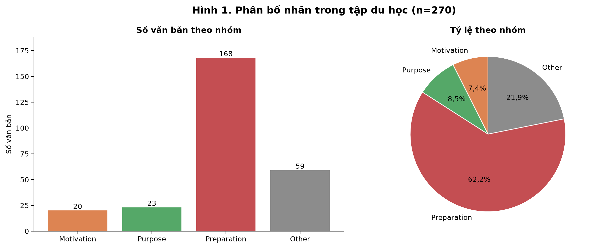
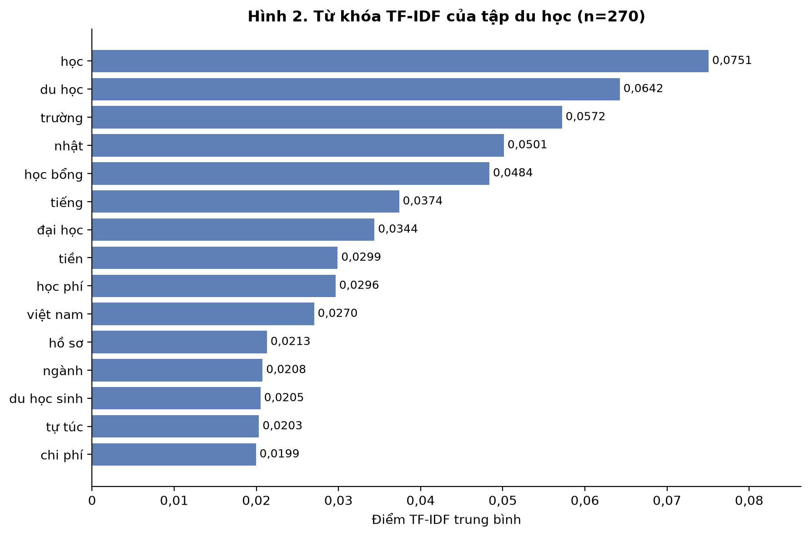
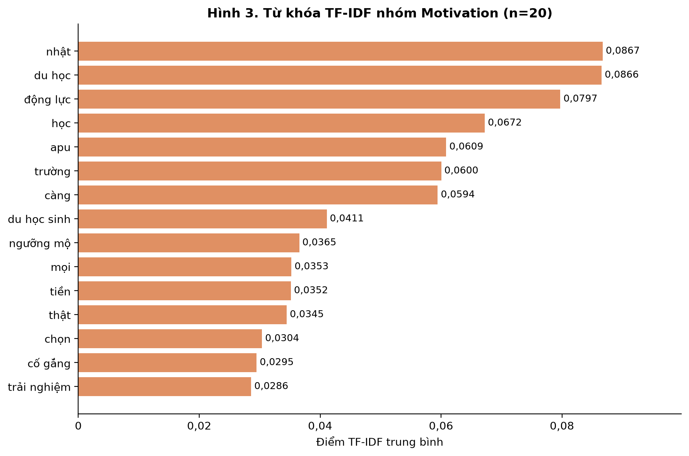
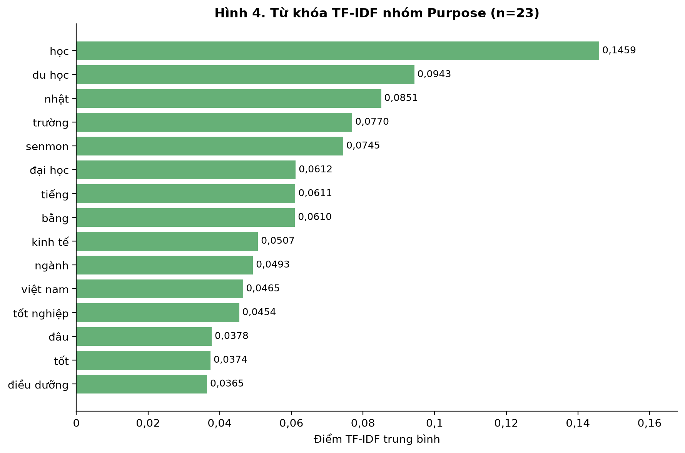
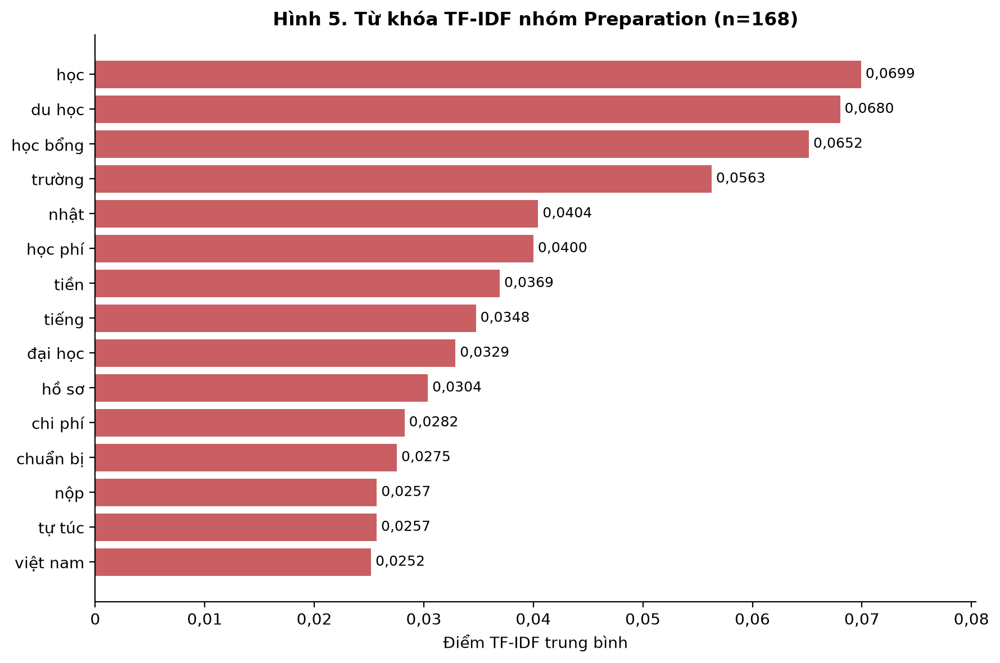
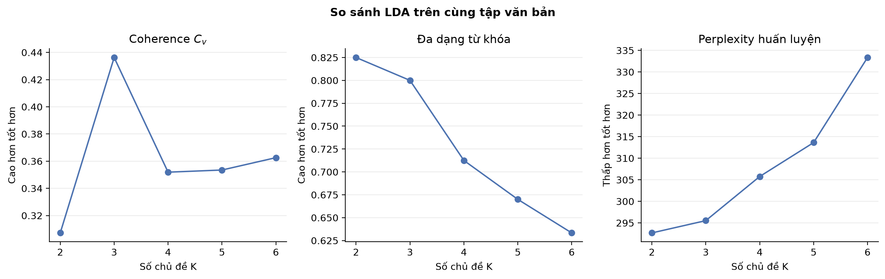
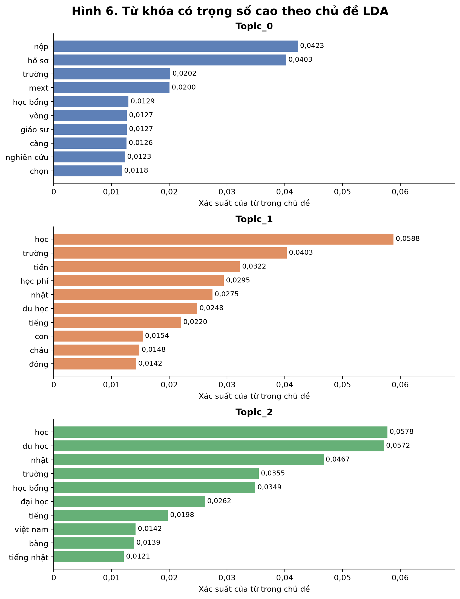
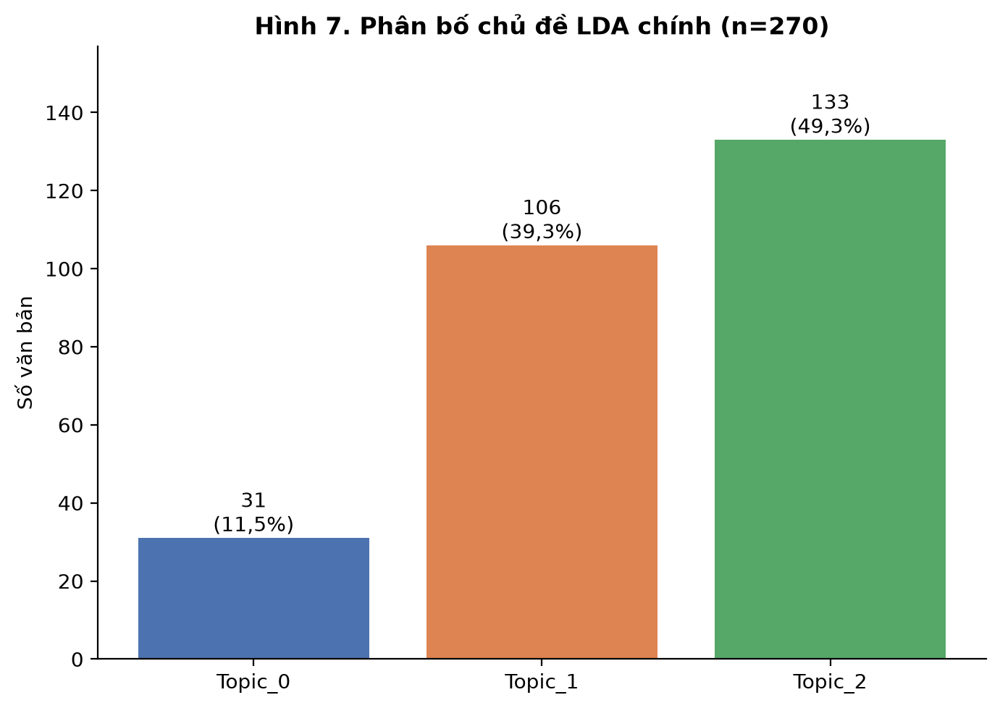
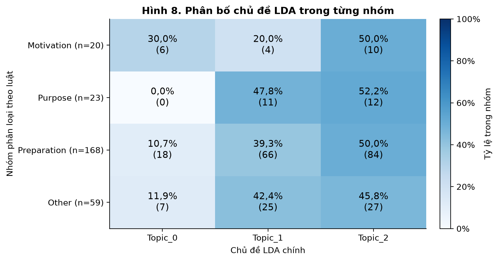

# AI for Business — Phân tích du học Nhật Bản của giới trẻ Việt Nam

Đề tài Term Project tại Đại học Duy Tân về động lực, mục đích và sự chuẩn bị của giới trẻ Việt Nam khi du học Nhật Bản.

## 1. Dữ liệu và phạm vi phân tích

Tệp `DATA_STUDY_IN_JAPAN_FINAL.csv` đã qua tuyển chọn và tiền xử lý, gồm **617 bản ghi** từ YouTube, website du học và VnExpress. Khi kiểm tra lại, pipeline loại một bình luận quảng cáo và giữ **616 bản ghi**.

| Nguồn | Đầu vào | Qua làm sạch | Liên quan | Ngoài phạm vi | Chờ duyệt |
|---|---:|---:|---:|---:|---:|
| YouTube | 424 | 423 | 270 | 2 | 151 |
| Website du học | 191 | 191 | 172 | 5 | 14 |
| VnExpress | 2 | 2 | 0 | 0 | 2 |
| **Tổng** | **617** | **616** | **442** | **7** | **167** |

TF-IDF, LDA, các hình và bản xuất Orange sử dụng **270 bình luận YouTube** mà bộ lọc đánh giá có liên quan đến du học Nhật Bản. Các dòng `uncertain` chờ duyệt thủ công. [Kết quả lọc theo mã bản ghi](results/study_japan/relevance_summary.csv)

## 2. Quy trình xử lý

Pipeline kiểm tra CSV, gán nhãn và đánh giá phạm vi. TF-IDF và LDA sử dụng các dòng có `source = YouTube` và `relevance_status = relevant`. Thực nghiệm LDA thử K từ 2 đến 6 trên cùng tập với seed 42.

```bash
python -m venv .venv
source .venv/bin/activate
pip install -r requirements.txt
python -m unittest discover -s tests -v
```

Để chạy lại phân tích trong một thư mục tạm, thay đường dẫn bên dưới bằng vị trí tệp CSV trên máy.

```bash
python - "$HOME/Downloads/DATA_STUDY_IN_JAPAN_FINAL.csv" <<'PY'
import sys
from pathlib import Path
from tempfile import mkdtemp

from src.classification import classify_dataset
from src.cleaning import clean_dataset
from src.lda import run_lda_analysis
from src.lda_evaluation import evaluate_topic_counts
from src.tfidf import run_tfidf_analysis

output = Path(mkdtemp(prefix="study-japan-"))
cleaned = output / "cleaned.csv"
clean_dataset(Path(sys.argv[1]), cleaned)
classified, _ = classify_dataset(cleaned, output / "classified.csv", output / "manual_review.csv")
youtube = output / "youtube.csv"
classified.loc[classified["source"].eq("YouTube")].to_csv(youtube, index=False, encoding="utf-8-sig")
run_tfidf_analysis(youtube, output / "tfidf_results.csv")
run_lda_analysis(youtube, output / "lda_topics.csv", output / "lda_doc_topics.csv", n_topics=3)
evaluate_topic_counts(youtube, output, review_k=3)
print(output)
PY
```

## 3. Xuất dữ liệu cho Orange Data Mining

Mở [CSV Orange](results/study_japan/orange_data.csv) và chọn `text_model` làm cột văn bản trong **Corpus**. Trong **Preprocess Text**, dùng Regexp `\w+` để giữ từ ghép có dấu gạch dưới, sau đó nối với **Word Cloud**. Dùng cột `category` để xem từng nhãn.

Xuất bốn ảnh từ Orange cho báo cáo gồm Động lực (`Motivation`, 20 bình luận), Mục đích (`Purpose`, 23), Chuẩn bị (`Preparation`, 168) và Tổng quan (270, dùng toàn bộ CSV).

## 4. Kết quả phân tích

### 4.1. Phân bố nhãn

| Nhãn | 616 dòng đã kiểm tra | 270 bình luận YouTube dùng cho phân tích |
|---|---:|---:|
| Motivation | 64 | 20 |
| Purpose | 50 | 23 |
| Preparation | 325 | 168 |
| Other | 177 | 59 |
| **Tổng** | **616** | **270** |



*Hình 1.* Nhóm Preparation chiếm 168 trên 270 bình luận. 59 bình luận thuộc Other vẫn đạt tiêu chí liên quan và được dùng trong TF-IDF tổng thể và LDA.

### 4.2. TF-IDF tổng thể và theo nhóm



*Hình 2.* Các từ khóa có điểm cao gồm `học`, `du_học`, `trường`, `nhật` và `học_bổng`. [Bảng điểm TF-IDF](results/study_japan/tfidf_results.csv)



*Hình 3.* TF-IDF trên 20 bình luận Motivation.



*Hình 4.* TF-IDF trên 23 bình luận Purpose.



*Hình 5.* TF-IDF trên 168 bình luận Preparation.

### 4.3. Số chủ đề và kết quả LDA

Trong các mô hình K từ 2 đến 6 trên 270 bình luận và 491 từ hoặc cụm từ, **K = 3** có coherence Cᵥ cao nhất (**0,4363**), với độ đa dạng chủ đề **0,8000** và perplexity trên tập huấn luyện **295,53**. Tên chủ đề được diễn giải từ từ khóa và bình luận tiêu biểu. [Bảng đánh giá số chủ đề](results/study_japan/lda_evaluation.csv)





*Hình 6.* Mười từ khóa có trọng số cao nhất của mỗi chủ đề. [Trọng số từ khóa](results/study_japan/lda_topics.csv)

| Chủ đề | Số bình luận | Diễn giải |
|---|---:|---|
| Topic_0 | 31 | Hồ sơ MEXT và chuẩn bị học bổng |
| Topic_1 | 106 | Học phí, sinh hoạt phí và làm thêm |
| Topic_2 | 133 | Lựa chọn chương trình và lộ trình học |



*Hình 7.* Mỗi bình luận được đếm theo chủ đề có xác suất cao nhất. [Chủ đề theo mã bình luận](results/study_japan/lda_doc_topics.csv)



*Hình 8.* Mỗi ô thể hiện số bình luận và tỷ lệ của một chủ đề trong từng nhãn phân loại.
