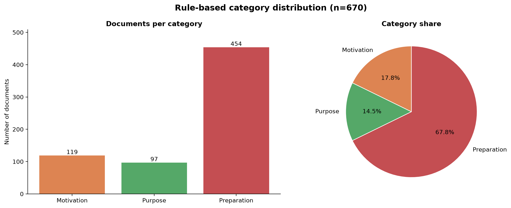
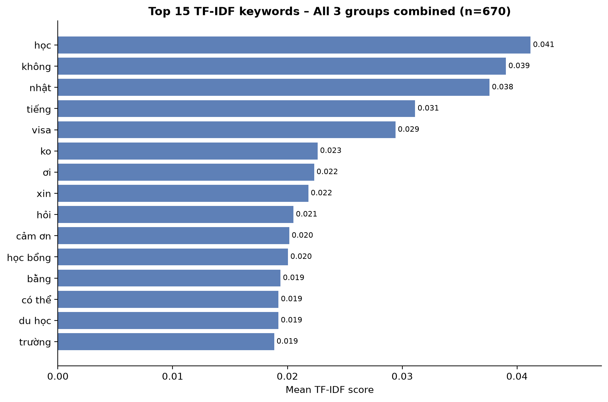
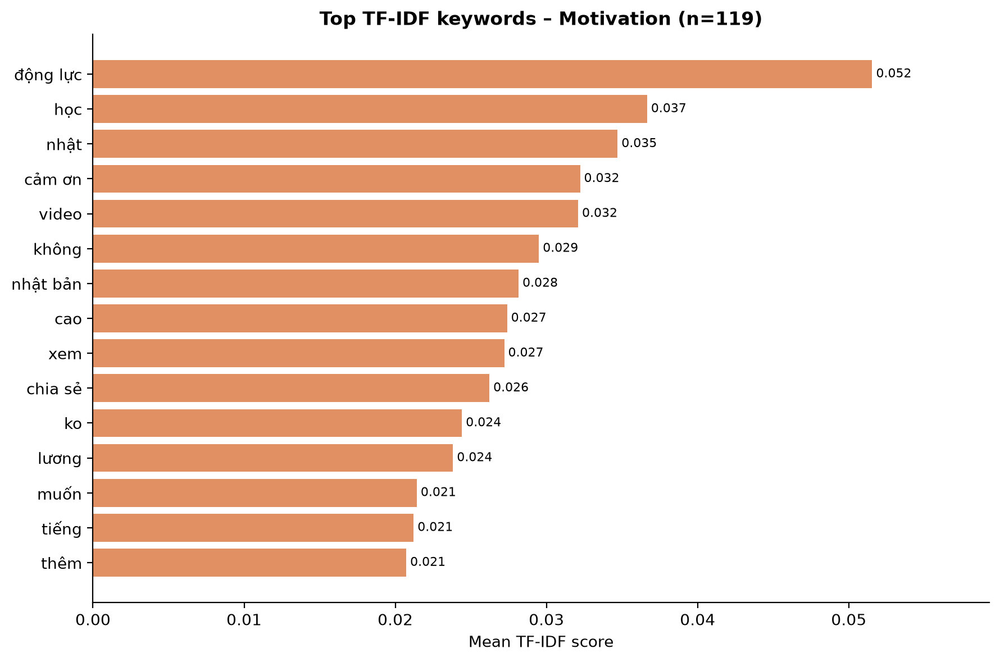
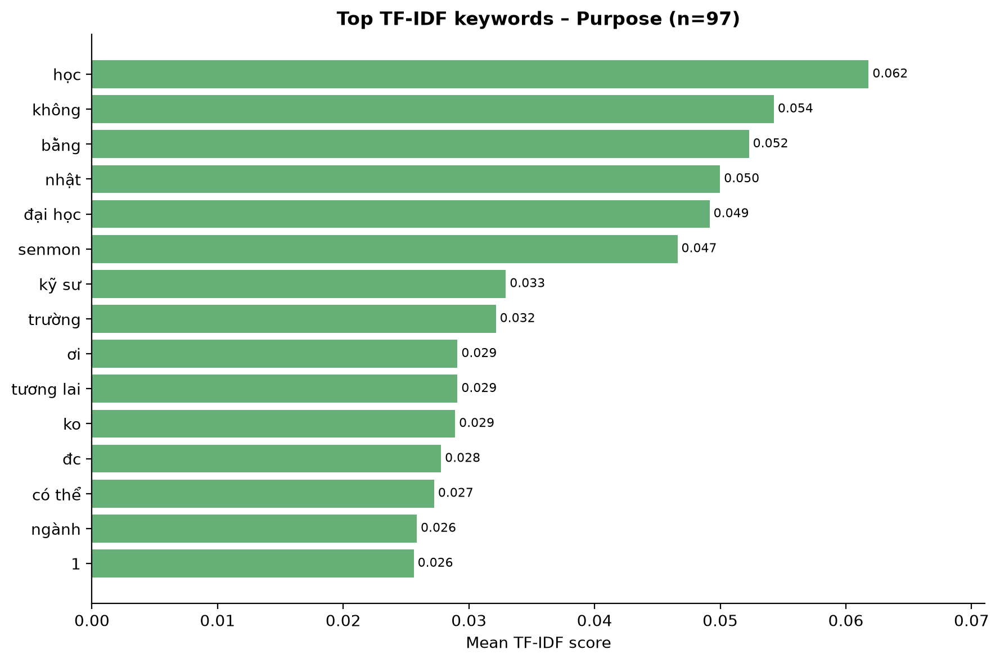
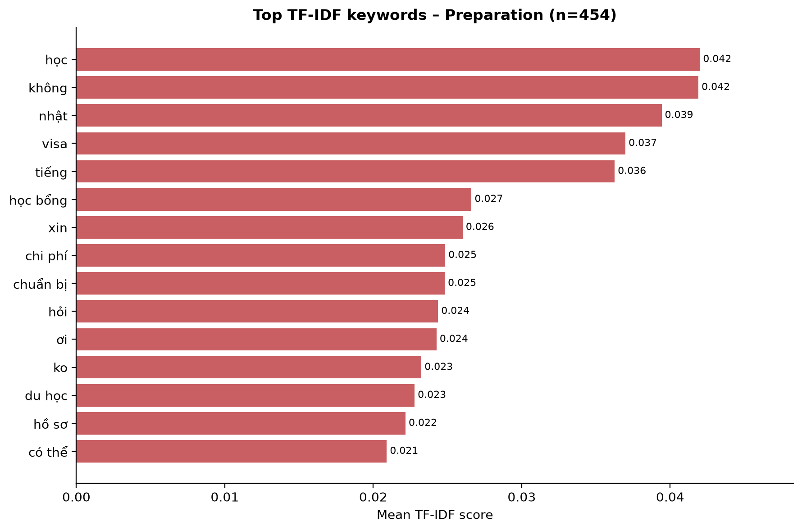
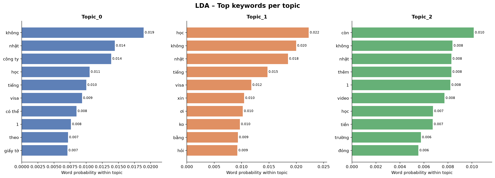
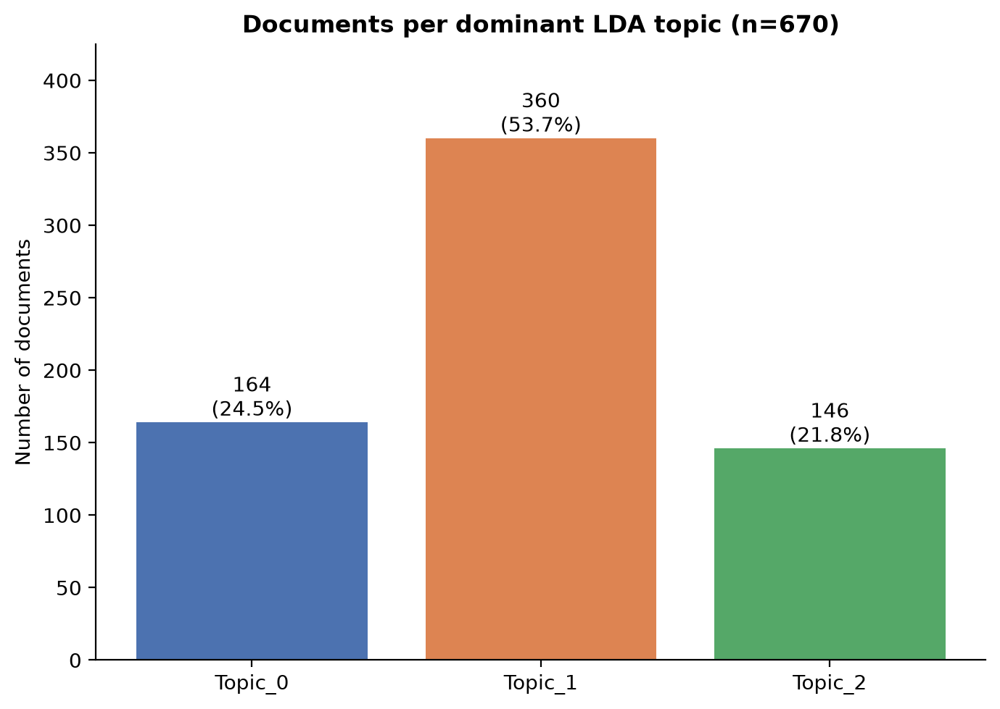
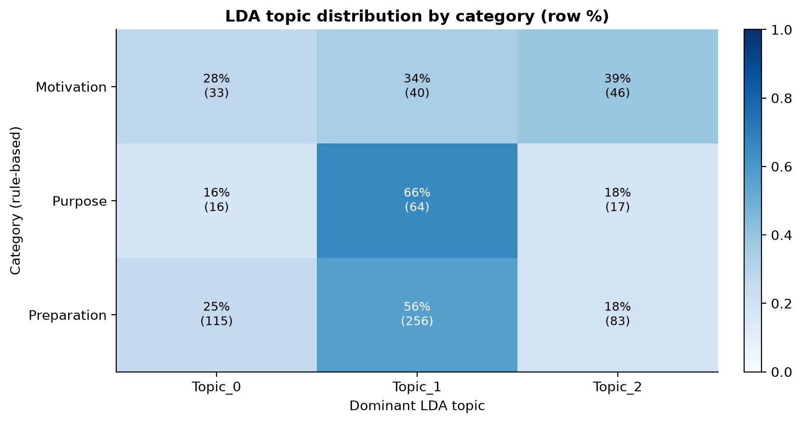

# AI for Business — Phân tích du học Nhật Bản của giới trẻ Việt Nam

Đề tài Term Project môn **AI for Business** (Đại học Duy Tân): *Phân tích động lực, mục đích và sự chuẩn bị của giới trẻ Việt Nam khi du học Nhật Bản*.

## 1. Cấu trúc thư mục

- `data/raw/raw_data.csv`: Dữ liệu gốc (UTF-8 CSV, tối thiểu gồm cột `text`, `created_at`; khuyến khích có `text_id`). Không bị sửa đổi hay ghi đè bởi pipeline.
- `data/raw/sample_test_data.csv`: Bộ dữ liệu giả lập (26 dòng) dùng riêng cho kiểm thử pipeline, tách biệt hoàn toàn với `raw_data.csv`.
- `data/processed/cleaned_data.csv`: Dữ liệu sau khi làm sạch, lọc ngày (sau 01/2022), ẩn danh PII và tách từ tiếng Việt (`underthesea`).
- `data/processed/classified_data.csv`: Dữ liệu đã gán nhãn thử nghiệm (`Motivation`, `Purpose`, `Preparation`, `Other`) bằng bộ phân loại rule-based có giải thích.
- `data/processed/manual_review_needed.csv`: Danh sách các văn bản mơ hồ / thiếu từ khóa cần kiểm tra thủ công.
- `data/exports/orange_data.csv`: File xuất chuẩn UTF-8-SIG dành cho **Orange Data Mining** (gửi cho thành viên nhóm 3).
- `results/tfidf_results.csv`: Top từ khóa TF-IDF tổng thể (`ALL`) và theo từng nhóm.
- `results/lda_topics.csv`: Chủ đề tiềm ẩn từ LDA (dùng ma trận tần suất từ `CountVectorizer`).
- `results/lda_doc_topics.csv`: Phân bố xác suất chủ đề theo từng văn bản.
- `results/metrics.json`: Thống kê tổng hợp của toàn bộ pipeline.
- `results/figures/`: 8 biểu đồ PNG (TF-IDF, LDA, phân bố nhóm) sinh tự động bởi `src/visualize.py` — xem mục 4.

## 2. Cách chạy

Kích hoạt môi trường ảo:

```bash
source .venv/bin/activate
```

Chạy toàn bộ pipeline với dữ liệu chính thức (`data/raw/raw_data.csv`):

```bash
python main.py
```

Chạy kiểm thử với dữ liệu giả lập:

```bash
python main.py --input data/raw/sample_test_data.csv
```

Chỉ xuất lại file cho Orange (không chạy lại các bước trước):

```bash
python main.py --export-only
```

Chỉ vẽ lại biểu đồ từ kết quả đã có (không chạy lại các bước trước):

```bash
python main.py --plots-only
```

## 3. Hướng dẫn cho người dùng Orange Data Mining

1. Mở file `data/exports/orange_data.csv` bằng widget **CSV File Import** (hoặc **Corpus** trong Text Mining).
2. Chọn `text_segmented` (hoặc `text_cleaned`) làm cột văn bản (*Text*), và `category` làm biến phân loại (*Categorical*).
3. Dùng widget **Select Rows** để lọc theo `category` (`Motivation`, `Purpose`, `Preparation`, `Other`).
4. Nối với widget **Word Cloud** để xem trực quan hóa tổng thể và theo từng nhóm mà không cần viết code.

## 4. Biểu đồ kết quả (`results/figures/`)

Các biểu đồ được sinh tự động ở bước cuối của `python main.py` (hoặc `python main.py --plots-only`). Dữ liệu đầu vào: file Excel `data/raw/DATA_COLLECTION_TEXT_ANALYSIS_STUDY_IN_JAPAN_P2.xlsx` (1.511 dòng → 1.447 dòng sau làm sạch).

| # | File | Nội dung |
|---|------|----------|
| 1 | `01_phan_bo_nhom_phan_loai.png` | Số lượng và tỷ lệ văn bản của 3 nhóm Motivation / Purpose / Preparation (670 văn bản) |
| 2 | `02_tfidf_tu_khoa_tong_the.png` | Top 15 từ khóa TF-IDF của **tổng cả 3 nhóm** (All = Motivation + Purpose + Preparation) |
| 3 | `03_tfidf_nhom_dong_luc_motivation.png` | Top 15 từ khóa TF-IDF nhóm **Động lực (Motivation)** |
| 4 | `04_tfidf_nhom_muc_dich_purpose.png` | Top 15 từ khóa TF-IDF nhóm **Mục đích (Purpose)** |
| 5 | `05_tfidf_nhom_chuan_bi_preparation.png` | Top 15 từ khóa TF-IDF nhóm **Chuẩn bị (Preparation)** |
| 6 | `06_lda_tu_khoa_tung_chu_de.png` | Top 10 từ khóa của từng chủ đề LDA (Topic_0, Topic_1, Topic_2), mô hình chạy trên 670 văn bản của 3 nhóm |
| 7 | `07_lda_phan_bo_chu_de.png` | Số văn bản thuộc mỗi chủ đề LDA chính |
| 8 | `08_lda_chu_de_vs_nhom_phan_loai.png` | Heatmap mối liên hệ giữa chủ đề LDA và các nhóm phân loại |

### 4.1. Phân bố nhóm phân loại


### 4.2. TF-IDF








### 4.3. LDA






> **Phạm vi phân tích:** TF-IDF, LDA và toàn bộ biểu đồ chỉ dùng 3 nhóm **Motivation, Purpose, Preparation** (670 văn bản). Nhóm `Other` (777 văn bản) vẫn nằm trong `classified_data.csv` / `orange_data.csv` nhưng không đưa vào TF-IDF, LDA và biểu đồ.

> **Lưu ý:** Chủ đề LDA là cụm thống kê không giám sát, **không** tự động tương ứng với Motivation / Purpose / Preparation. Biểu đồ 8 chỉ dùng để so sánh mức độ trùng khớp. Ảnh **Word Cloud** được tạo riêng trong Orange Data Mining (xem mục 3).
