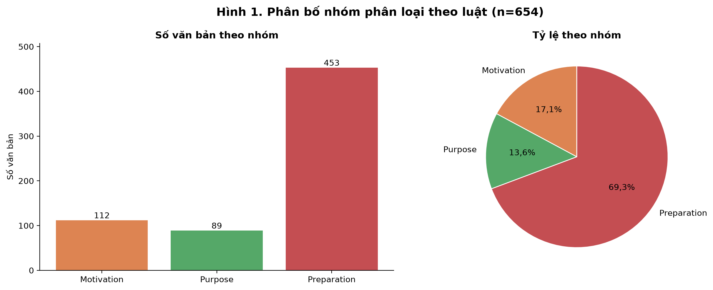
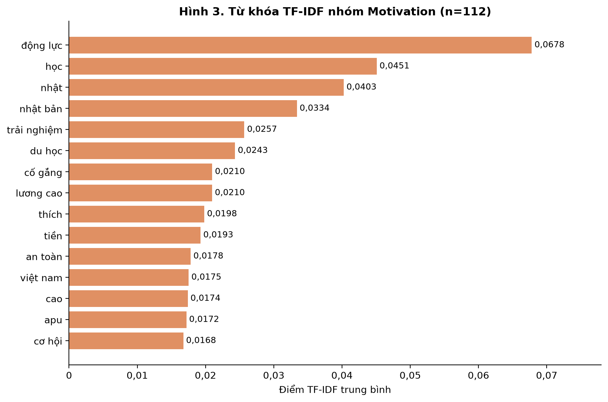
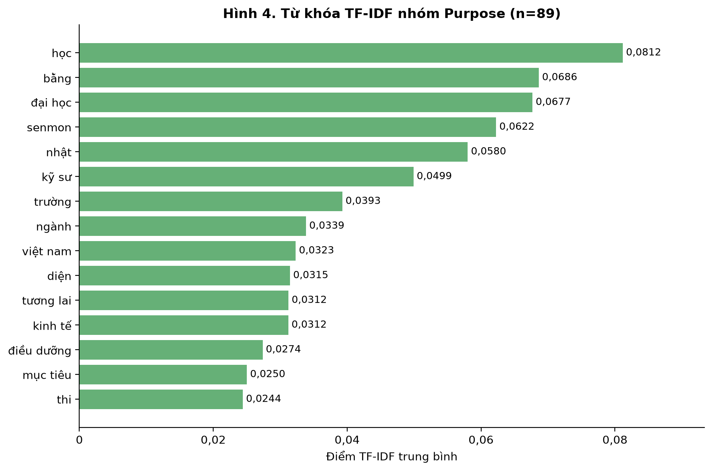
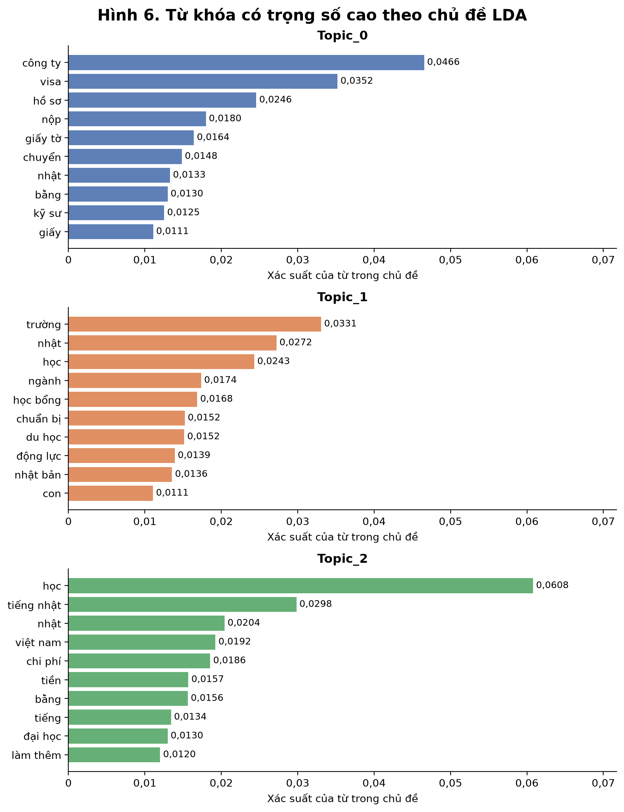
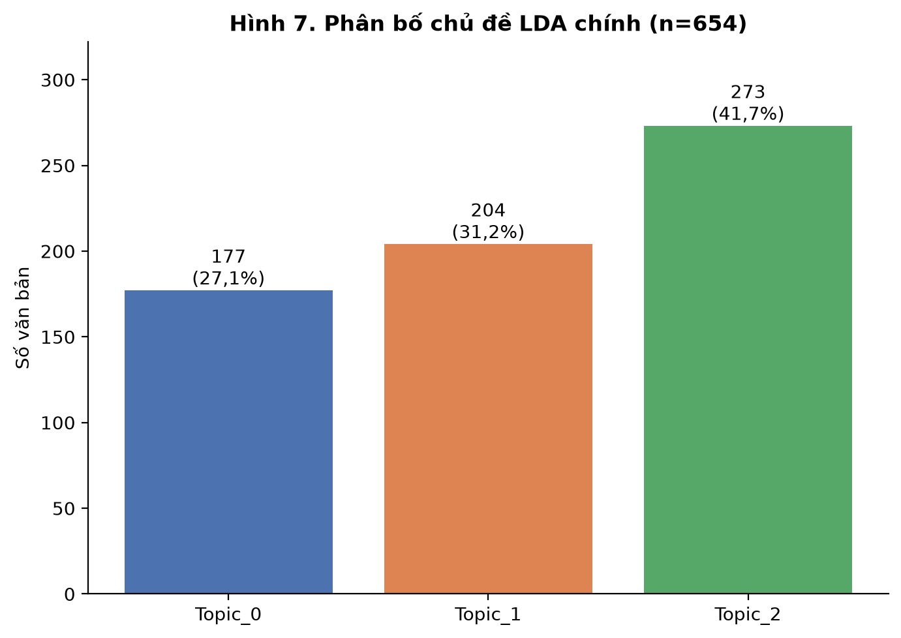
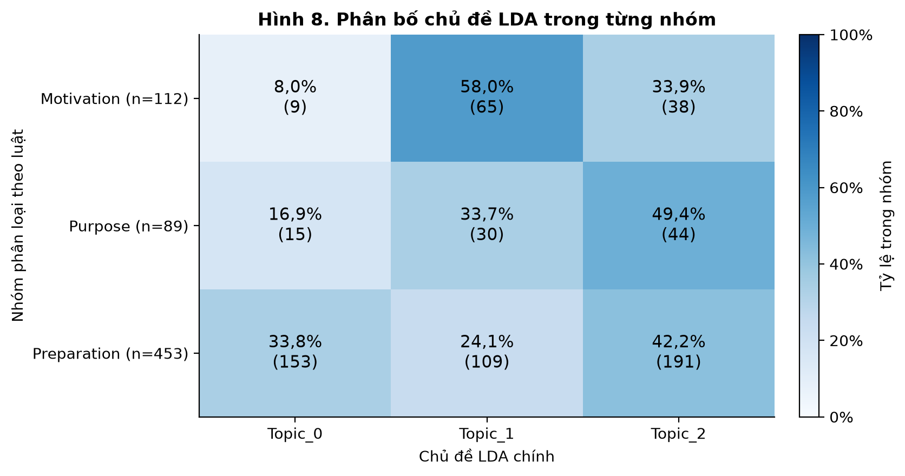

# AI for Business — Phân tích du học Nhật Bản của giới trẻ Việt Nam

Đề tài Term Project môn **AI for Business** (Đại học Duy Tân): *Phân tích động lực, mục đích và sự chuẩn bị của giới trẻ Việt Nam khi du học Nhật Bản*.

## 1. Cấu trúc thư mục

- `data/raw/DATA_COLLECTION_TEXT_ANALYSIS_STUDY_IN_JAPAN_P2.xlsx` là bộ dữ liệu gốc. Pipeline cũng đọc CSV UTF-8 có cột `text`, `created_at` và mã `text_id` nếu có.
- [Danh sách loại qua đọc thủ công](data/reviewed_exclusions.csv) ghi mã và lý do loại từng dòng đã đọc trong workbook gốc.
- `data/processed/cleaned_data.csv`: Dữ liệu sau khi làm sạch, lọc ngày (sau 01/2022), ẩn danh PII và tách từ tiếng Việt (`underthesea`).
- `data/processed/classified_data.csv`: Dữ liệu đã gán nhãn thử nghiệm (`Motivation`, `Purpose`, `Preparation`, `Other`) bằng bộ phân loại rule-based có giải thích.
- `data/processed/manual_review_needed.csv`: Danh sách các văn bản mơ hồ / thiếu từ khóa cần kiểm tra thủ công.
- `data/exports/orange_data.csv`: File xuất chuẩn UTF-8-SIG dành cho **Orange Data Mining** (gửi cho thành viên nhóm 3).
- `results/tfidf_results.csv`: Top từ khóa TF-IDF tổng thể (`ALL`) và theo từng nhóm.
- `results/lda_topics.csv`: Chủ đề tiềm ẩn từ LDA (dùng ma trận tần suất từ `CountVectorizer`).
- `results/lda_doc_topics.csv`: Phân bố xác suất chủ đề theo từng văn bản.
- `results/metrics.json`: Thống kê tổng hợp của toàn bộ pipeline.
- `results/figures/`: 8 biểu đồ PNG (TF-IDF, LDA, phân bố nhóm) sinh tự động bởi `src/visualize.py` — xem mục 4.

## 2. Cách chạy

Kích hoạt môi trường ảo:

```bash
source .venv/bin/activate
```

Chạy toàn bộ pipeline với workbook được tự tìm trong `data/raw/`.

```bash
python main.py
```

Để chạy với một file đầu vào khác, truyền đường dẫn của file vào `--input`.

```bash
python main.py --input path/to/data.csv
```

Xuất lại file cho Orange từ dữ liệu đã phân loại.

```bash
python main.py --export-only
```

Vẽ lại biểu đồ từ các bảng kết quả đã lưu.

```bash
python main.py --plots-only
```

## 3. Hướng dẫn cho người dùng Orange Data Mining

Dùng `text_model` làm cột văn bản trong widget **Corpus**. Cột này dùng chung bộ từ dừng và quy tắc chuẩn hóa với TF-IDF và LDA. Để xem Word Cloud tổng thể theo cùng phạm vi phân tích, lọc ba nhóm Motivation, Purpose và Preparation bằng **Select Rows**. Sau đó chọn bộ tách từ Regexp `\w+` trong **Preprocess Text** và nối với **Word Cloud**. [Hướng dẫn Orange](data/exports/HUONG_DAN_ORANGE.txt)

## 4. Kết quả sau khi rà soát dữ liệu

Tám biểu đồ dưới đây dùng các file PNG `hinh_01_…` đến `hinh_08_…` do pipeline xuất. Điểm và tỷ lệ hiển thị theo dấu phẩy thập phân. [Thông tin lần chạy](results/metrics.json)

### 4.1. Dữ liệu và phân loại theo luật

Workbook có 1.511 dòng đầu vào. Pipeline giữ 1.439 dòng sau khi loại 26 dòng theo mốc thời gian, một dòng trùng, 28 bình luận được loại sau khi đọc thủ công vì lệch chủ đề, quảng bá hoặc lặp nội dung, 14 bình luận về xuất khẩu lao động thiếu dấu hiệu học tập, hai bình luận quảng bá và một dòng có lời dẫn của bản nháp bình luận. Các cụm như “tuyển sinh” và “xuất khẩu lao động” được xét theo ngữ cảnh. Chẳng hạn, bình luận `P1_0025` hỏi chọn trường dựa trên chỉ tiêu tuyển sinh và học phí đã được giữ lại. [Số liệu làm sạch](results/metrics.json) · [Danh sách rà soát thủ công](data/reviewed_exclusions.csv)

Trong workbook, pipeline ưu tiên cột `text_anonymized` để đọc và tách từ, sau đó tiếp tục che thông tin liên hệ theo mẫu. Bộ phân loại so khớp theo ranh giới từ. TF-IDF và LDA dùng 654 văn bản thuộc ba nhóm trong Hình 1. 785 văn bản `Other` vẫn có trong dữ liệu xuất, trong đó có những bình luận liên quan nhưng thiếu cụm khớp luật hoặc có điểm hòa. 815 dòng được đánh dấu cần rà soát nhãn hoặc bổ sung ngữ cảnh. [Dữ liệu đã phân loại](data/processed/classified_data.csv) · [Hàng chờ rà soát](data/processed/manual_review_needed.csv)



*Hình 1.* Preparation chiếm 453/654 văn bản (69,3%), tiếp theo là Motivation (112) và Purpose (89). Chênh lệch kích thước nhóm ảnh hưởng đến số lượng tuyệt đối trong các hình LDA.

### 4.2. TF-IDF tổng thể và theo nhóm

Bộ lọc dùng chung loại từ đệm, biến thể viết tắt trong hội thoại, mã emoji và số rời. Các cụm có nghĩa được ghép và chuẩn hóa trước khi lọc. Ví dụ, `cty` thành `công_ty`, `kĩ sư` thành `kỹ_sư`, và `xin_visa` vẫn được giữ dù từ “xin” đứng riêng bị lọc.


*Hình 2.* Trong top 15 của 654 văn bản, các từ về học tập, giấy tờ và tài chính như “visa”, “tiếng Nhật”, “học bổng” và “chi phí” có điểm cao. “Ơi”, “cảm ơn”, “xin”, “hỏi”, “ko”, “k” và “hok” vắng mặt trong cả bốn bảng top 15. [Bảng điểm TF-IDF](results/tfidf_results.csv)



*Hình 3.* “Động lực”, “trải nghiệm”, “lương cao” và “an toàn” cùng xuất hiện trong top 15, cho thấy nhóm đề cập cả lý do cá nhân lẫn kỳ vọng về thu nhập và môi trường sống.



*Hình 4.* “Bằng”, “đại học”, “senmon”, “kỹ sư” và “điều dưỡng” làm rõ các lựa chọn bằng cấp, bậc học và nghề nghiệp xuất hiện trong nhóm.


*Hình 5.* “Visa”, “tiếng Nhật”, “học bổng”, “chi phí” và “hồ sơ” cho thấy người viết thảo luận về cả thủ tục, năng lực ngoại ngữ và cách trang trải chi phí.

### 4.3. Diễn giải từng chủ đề LDA

LDA dùng tần suất từ trên 654 văn bản với 964 từ hoặc cụm từ xuất hiện trong ít nhất hai văn bản. Tên dưới đây được đặt sau khi đối chiếu các từ có trọng số cao với nội dung của những bình luận có xác suất chủ đề cao. Mã `Topic_0`, `Topic_1` và `Topic_2` gắn với lần chạy này. [Từ khóa LDA](results/lda_topics.csv) · [Xác suất theo văn bản](results/lda_doc_topics.csv)



*Hình 6.* Ba chủ đề cùng dùng một thang trọng số. Có thể đối chiếu các bình luận đại diện dưới đây bằng cột `text_id`. Nội dung ví dụ được tóm tắt từ bình luận. [Văn bản đã làm sạch](data/processed/cleaned_data.csv)

| Chủ đề | Nội dung | Bình luận đại diện |
| --- | --- | --- |
| **Topic_0 · Visa, hồ sơ và chuyển việc** | Các trao đổi về nộp hoặc gia hạn hồ sơ, xác nhận từ công ty và thủ tục khi đổi việc. Từ nổi bật gồm “công ty”, “visa”, “hồ sơ”, “nộp” và “giấy tờ”. | `P4_0014` (99,4%) bàn về giấy nghỉ việc và giấy tờ từ công ty mới. `P4_0019` (98,4%) hỏi cách xử lý khi hồ sơ gia hạn nộp trực tuyến chưa có kết quả. |
| **Topic_1 · Chọn trường, ngành và lý do du học** | Người viết cân nhắc trường, ngành, cơ hội sau tốt nghiệp và điều kiện theo học tại Nhật. Từ nổi bật gồm “trường”, “ngành”, “học bổng”, “du học” và “động lực”. | `P1_0025` (97,6%) hỏi nên chọn trường công hay tư vì khác nhau về cơ hội trúng tuyển và học phí. `P4_0105` (99,2%) cân nhắc môi trường quốc tế của APU và triển vọng tìm việc sau tốt nghiệp. |
| **Topic_2 · Học tiếng Nhật và chi phí theo học** | Chủ đề gom các trao đổi về khả năng theo học, gồm tự học tiếng Nhật, chi phí sinh hoạt, nguồn hỗ trợ và làm thêm. Từ nổi bật gồm “tiếng Nhật”, “chi phí”, “tiền”, “đại học” và “làm thêm”. | `P2_0764` (97,9%) bàn về chênh lệch giữa chứng chỉ JLPT và khả năng giao tiếp. `P1_0005` (98,8%) tính tiền nhà, sinh hoạt và khả năng trang trải học phí bằng thu nhập làm thêm. `P2_0467` (97,1%) nối hai mảng khi cân nhắc học trường tiếng để luyện EJU và dùng học bổng báo để theo học. |



*Hình 7.* Mỗi văn bản được đếm một lần theo chủ đề có xác suất cao nhất. Topic_2 đứng đầu với 273/654 văn bản (41,7%), tiếp theo là Topic_1 với 204 (31,2%) và Topic_0 với 177 (27,1%). Topic_2 bao quát cả ngoại ngữ và khả năng trang trải chi phí. Nhóm Preparation đóng góp 191/273 văn bản của chủ đề này, phù hợp với việc Preparation chiếm phần lớn mẫu phân tích. Các tỷ lệ mô tả bộ bình luận được đưa vào mô hình. [Bảng phân bố theo văn bản](results/lda_doc_topics.csv)



*Hình 8.* Nhãn mỗi hàng ghi tổng số văn bản của nhóm (`n`). Mỗi ô ghi tỷ lệ văn bản thuộc topic trong nhóm đó và số văn bản trong ngoặc. Tổng tỷ lệ theo hàng có thể chênh nhẹ so với 100% do làm tròn.

- **Motivation** tập trung nhất ở Topic_1 (65/112, 58,0%), phù hợp với các trao đổi về lý do chọn trường và dự định du học. Topic_2 cũng có 38/112 văn bản (33,9%).
- **Purpose** nghiêng về Topic_2 (44/89, 49,4%), tiếp đến là Topic_1 (30/89, 33,7%). Các trao đổi về bậc học hoặc nghề nghiệp có thể đi cùng câu hỏi về năng lực tiếng Nhật và chi phí.
- **Preparation** trải trên cả ba chủ đề. Topic_2 chiếm 42,2% (191/453), Topic_0 chiếm 33,8% (153/453) và Topic_1 chiếm 24,1% (109/453). Nhóm này bao gồm cả thủ tục, chọn trường, ngoại ngữ và tài chính.

LDA gom các văn bản theo từ xuất hiện cùng nhau, còn Classification dựa trên luật từ khóa. Heatmap mô tả độ giao nhau của hai cách phân tích. Độ chính xác của Classification cần được đánh giá riêng bằng nhãn tham chiếu đã xác minh, có xét việc workbook cho phép nhiều nhãn trên một văn bản. Một số bình luận vẫn cần đọc cùng ngữ cảnh nguồn, đặc biệt khi nói về việc làm và lưu trú tại Nhật. [Bảng chủ đề theo văn bản](results/lda_doc_topics.csv)
