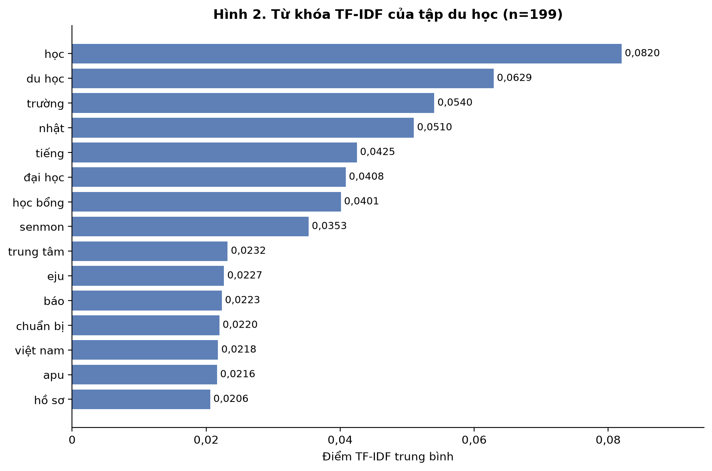
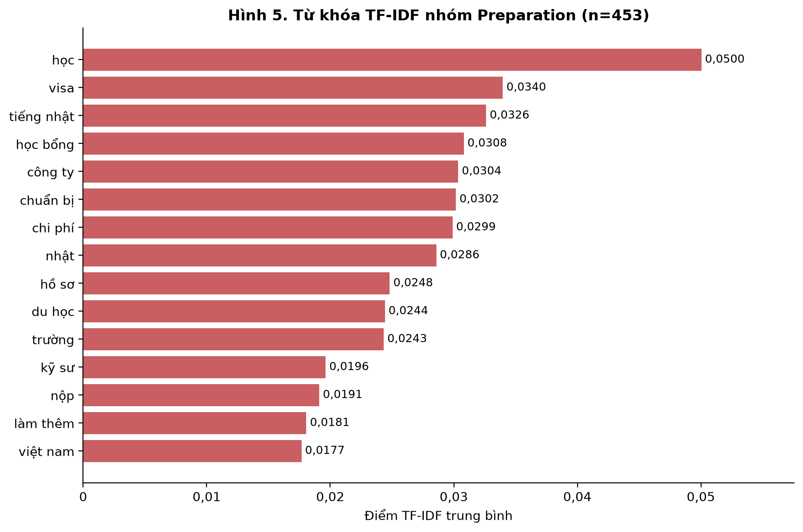
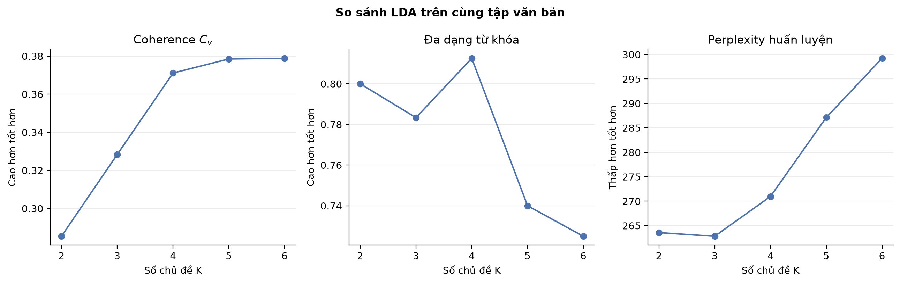

# AI for Business — Phân tích du học Nhật Bản của giới trẻ Việt Nam

Đề tài Term Project tại Đại học Duy Tân về động lực, mục đích và sự chuẩn bị của giới trẻ Việt Nam khi du học Nhật Bản.

## 1. Dữ liệu và kết quả

- [Workbook nguồn](data/raw/DATA_COLLECTION_TEXT_ANALYSIS_STUDY_IN_JAPAN_P2.xlsx) và [danh sách loại trừ đã rà soát](data/reviewed_exclusions.csv).
- [Dữ liệu sạch](data/processed/cleaned_data.csv), [dữ liệu đã phân loại](data/processed/classified_data.csv), [kết quả lọc phạm vi](data/processed/relevance_review.csv) và [hàng chờ duyệt](data/processed/manual_review_needed.csv).
- [Thống kê pipeline](results/metrics.json) và [báo cáo kiểm chứng kết quả mới nhất](results/RELEVANCE_AND_LDA_FINAL_REPORT.md).

## 2. Cách chạy

Kích hoạt môi trường ảo của dự án.

```bash
source .venv/bin/activate
```

Pipeline tự tìm workbook trong `data/raw/`. Lệnh thứ hai chạy thực nghiệm K = 2–6 trên cùng tập văn bản đã lọc.

```bash
python main.py
python -m src.lda_evaluation
```

| Mục đích | Lệnh |
|---|---|
| Dùng tệp đầu vào khác | `python main.py --input path/to/data.csv` |
| Xuất lại CSV Orange | `python main.py --export-only` |
| Vẽ lại Hình 1–8 từ kết quả đã lưu | `python main.py --plots-only` |
| Chạy các test lọc phạm vi | `python -m unittest discover -s tests -v` |

## 3. Xuất dữ liệu cho Orange Data Mining

[CSV Orange](data/exports/orange_data.csv) chứa toàn bộ 1.453 dòng sạch. Trong widget **Corpus**, dùng `text_model` làm cột văn bản. Tách từ bằng Regexp `\w+` trong **Preprocess Text**, sau đó nối với **Word Cloud**. Có thể lọc theo `category` để xem từng nhãn. Để tái lập đúng tập TF-IDF/LDA, đối chiếu `text_id` với [các dòng `relevant` trong bảng phạm vi](data/processed/relevance_review.csv). [Hướng dẫn Orange](data/exports/HUONG_DAN_ORANGE.txt)

## 4. Kết quả phân tích

Từ **1.511 bản ghi thô**, pipeline giữ **1.453 dòng sạch** và loại **58 dòng**. Bộ lọc phạm vi xác định **199 dòng `relevant`**, **222 dòng `off_topic` theo quy tắc** và **1.032 dòng `uncertain` cần duyệt**. TF-IDF tổng thể và LDA cùng sử dụng 199 văn bản `relevant`. [Thống kê lần chạy](results/metrics.json)

### 4.1. Phân bố nhãn

| Nhãn | Toàn bộ dữ liệu sạch | Tập phân tích |
|---|---:|---:|
| Motivation | 101 | 16 |
| Purpose | 85 | 25 |
| Preparation | 372 | 100 |
| Other | 895 | 58 |
| **Tổng** | **1.453** | **199** |


*Hình 1.* Tập phân tích có 58 bình luận thuộc `Other` vẫn có bằng chứng liên quan đến du học.

### 4.2. TF-IDF tổng thể và theo nhóm



*Hình 2.* Các từ khóa có điểm cao trên 199 văn bản gồm `học`, `du_học`, `trường` và `nhật`. [Bảng điểm TF-IDF](results/tfidf_results.csv)


*Hình 3.* `động_lực`, `trải_nghiệm` và `apu` nằm trong nhóm từ khóa đứng đầu của 16 văn bản Motivation.


*Hình 4.* `senmon`, `đại_học` và `bằng` nổi bật trong 25 văn bản Purpose.



*Hình 5.* `du_học` và `học_bổng` đứng đầu trong 100 văn bản Preparation.

### 4.3. Số chủ đề và kết quả LDA

Pipeline dùng **K = 4** và từ vựng gồm **390 từ hoặc cụm từ**. So với K = 3, K = 4 giúp tách các trao đổi về hồ sơ và học bổng khỏi các trao đổi về học phí và sinh hoạt phí. K = 5 và K = 6 tăng nhẹ coherence nhưng giảm độ đa dạng từ khóa. Tên chủ đề dưới đây là diễn giải sơ bộ từ từ khóa và bình luận mẫu. [So sánh K = 2–6](results/lda_evaluation.csv) · [Bình luận mẫu](results/lda_topic_review.csv)




*Hình 6.* Mười từ khóa có trọng số cao nhất trong mỗi chủ đề. [Trọng số từ khóa](results/lda_topics.csv)

| Chủ đề | Số văn bản | Diễn giải tạm thời |
|---|---:|---|
| Topic_0 | 27 | Chọn trường và trải nghiệm học tại APU |
| Topic_1 | 39 | Hồ sơ và học bổng du học |
| Topic_2 | 107 | Lộ trình ngoại ngữ, trường tiếng và bậc học tiếp theo |
| Topic_3 | 26 | Học phí, sinh hoạt phí và khả năng trang trải |


*Hình 7.* Mỗi văn bản được đếm một lần theo chủ đề có xác suất cao nhất. [Chủ đề theo ID](results/lda_doc_topics.csv)


*Hình 8.* Mỗi ô thể hiện tỷ lệ và số văn bản của một chủ đề trong từng nhãn. Cả bốn nhãn, kể cả `Other`, được tính trong tập 199 văn bản.
